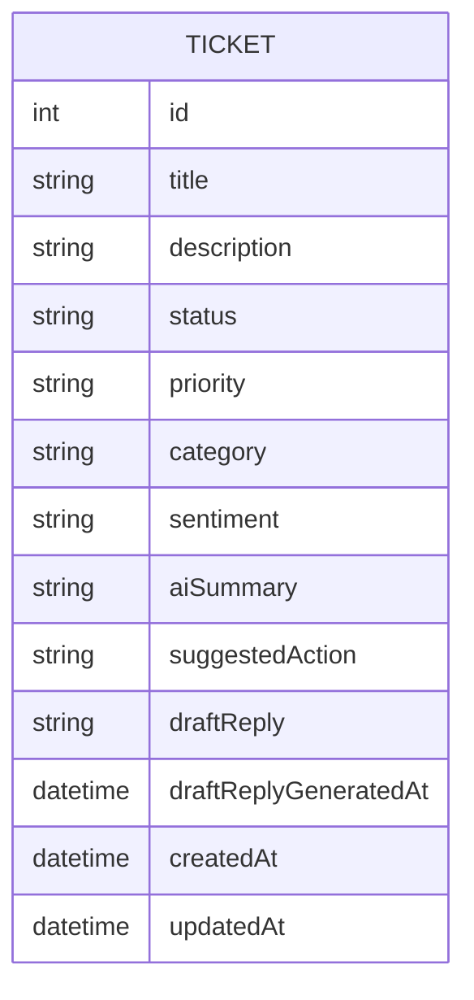

# Functional Spec — U1 Foundation & Tickets

Sources: U1 definition in `inception/units-generation/unit-of-work.md`, its stories in `unit-of-work-story-map.md`, FR1–FR6 and FR10 in `inception/requirements-analysis/requirements.md`, the Tickets component in `inception/domain-design/components.md`, and contracts C1/C3 in `inception/contract-design/contract-summary.md`. Data shape: `entities.md`. Decision logic: `rules.md`.

## Workflows

Every workflow runs request -> controller (maps HTTP only) -> ticket service (rules) -> database. Failures are raised as typed failures and turned into responses by the global error handler (BR6.1–BR6.4).

### WF1 — Create ticket (US1.1)
1. Receive title and description. If the body cannot be read, stop with 400 (BR6.3).
2. Trim both fields; validate title (BR1.1) and description (BR1.2). Collect every field error; if any, stop with 400.
3. Build a new ticket with defaults (BR1.4) and the trimmed text (BR1.3).
4. Save it; the database assigns the id (BR1.5).
5. Return 201 with a Location of `/api/tickets/{id}` and the ticket.

### WF2 — List tickets (US1.2)
1. Read optional status, priority, category query values.
2. Parse each present value to its enum, case-insensitively; an unknown value stops with 400 listing allowed values (BR2.3).
3. Query tickets matching all present filters (BR2.2), ordered newest createdAt first, then id descending (BR2.1).
4. Return 200 with the list, empty when nothing matches (BR2.4).

### WF3 — Get ticket (US1.3)
1. Validate the id (BR3.2).
2. Load the ticket; if absent, raise ticket-not-found -> 404 (BR3.1).
3. Return 200 with all fields (BR3.3).

### WF4 — Update ticket (US1.4)
1. Validate the id (BR3.2); read the body (BR6.3).
2. Validate title, description and priority together (BR4.1); any failure stops with 400 and the ticket is unchanged.
3. Load the ticket; if absent, 404 (BR3.1).
4. Apply only title, description, priority (BR4.2); set updatedAt (BR4.3); save.
5. Return 200 with the ticket.

### WF5 — Change status (US1.5)
1. Validate the id (BR3.2); read the body (BR6.3).
2. Parse status; missing or unknown stops with 400 listing allowed values (BR5.2).
3. Load the ticket; if absent, 404 (BR3.1).
4. Set the status (BR5.1); set updatedAt (BR4.3); save.
5. Return 200 with the ticket.

### WF6 — Error handling (US4.1)
1. Validation failures (model binding, field rules, bad id, bad enum, malformed body) produce 400 ProblemDetails with per-field errors where applicable (BR6.1, BR6.3).
2. Typed failures map through one table (BR6.4); in U1 only ticket-not-found occurs, the AI failures are raised by U2.
3. Anything else is logged (without secrets) and returned as a generic 500 (BR6.2).

U1 workflows never touch the AI service (BR6.5).

## State Machine — Ticket.status

All transitions are allowed (BR5.1); there are no terminal states. The table lists every pair.

| From \ To | Open | InProgress | Resolved | Closed |
|---|---|---|---|---|
| Open | allowed (no-op) | allowed | allowed | allowed |
| InProgress | allowed | allowed (no-op) | allowed | allowed |
| Resolved | allowed | allowed | allowed (no-op) | allowed |
| Closed | allowed | allowed | allowed | allowed (no-op) |

Initial state: Open (BR1.4). Each transition refreshes updatedAt (BR4.3). AI features in U2 work for any status.

## Entity-Relationship View (derived from entities.md)

<!-- Text fallback: one entity, TICKET, with id, title, description, status, priority, category, sentiment, aiSummary, suggestedAction, draftReply, draftReplyGeneratedAt, createdAt and updatedAt. It has no relationships. -->

## Rules Summary (derived from rules.md)

- Validation: BR1.1 title, BR1.2 description, BR2.3 filter values, BR3.2 id, BR4.1 update fields, BR5.2 status, BR6.3 malformed body.
- Policy: BR1.3 trimming, BR1.4 defaults, BR2.1 ordering, BR2.2 filters, BR2.4 empty list, BR3.3 full get, BR4.3 updatedAt, BR5.1 any-to-any status, BR6.1 ProblemDetails, BR6.2 generic 500, BR6.4 failure mapping.
- Constraints: BR1.5 durability, BR3.1 not found, BR4.2 update ignores status/AI fields, BR6.5 no AI calls.
