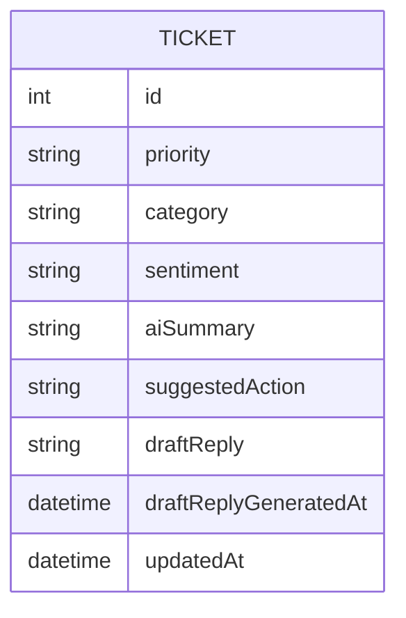

# Functional Spec — U2 AI Assistant

Sources: U2 definition in `inception/units-generation/unit-of-work.md`, its stories in `unit-of-work-story-map.md`, FR7/FR8/FR10/FR11 in `inception/requirements-analysis/requirements.md`, AiAssistant and Tickets in `inception/domain-design/components.md`, contracts C1–C4 in `inception/contract-design/contract-summary.md`. Data shapes: `entities.md`. Rules: `rules.md`.

## Workflows

The flow is controller -> Tickets service -> AiAssistant (`IAiTicketService`) -> Groq, and back: AiAssistant returns only a validated result or throws a typed failure; the Tickets service saves only validated results; the global error handler (U1) maps failures to status codes.

### WF7 — Analyze a ticket (US2.1, US2.2, US2.3)
1. Validate the id (U1 BR3.2). Load the ticket; if absent, 404 and stop (BR7.2).
2. Call `IAiTicketService.AnalyzeAsync(title, description)` (BR7.3).
3. AiAssistant: if no key, throw not-configured (BR10.1). Build the prompt (BR11.1); call Groq with the timeout (BR10.2).
4. AiAssistant: on timeout throw AI timeout; on HTTP/network/envelope error throw provider error (BR10.3).
5. AiAssistant: validate the content (BR8.1–BR8.4); on failure throw invalid output. Otherwise return `AiAnalysisResult`.
6. Tickets service: remember the old priority; apply category, sentiment, summary, suggested action and priority; set UpdatedAt; save once (BR7.4, BR7.5).
7. Return 200 with the five fields, `previousPriority` and the updated ticket.
Any failure in steps 3–5 leaves the ticket unchanged (BR7.6).

### WF8 — Draft a reply (US2.4)
1. Validate the id; load the ticket; 404 if absent (BR7.2).
2. Call `IAiTicketService.DraftReplyAsync(title, description, savedAnalysis-or-null)` (BR7.3).
3. AiAssistant: same not-configured, timeout and provider-error handling as WF7.
4. AiAssistant: validate the draft (BR9.1); return `AiDraftResult` or throw invalid output.
5. Tickets service: set DraftReply, DraftReplyGeneratedAt and UpdatedAt; save once (BR9.2).
6. Return 200 with ticketId, draft, generatedAt and the "not sent" notice (BR9.3). Nothing is sent anywhere (BR9.4).

### WF9 — Configuration at startup (US2.5)
1. Bind `Ai` settings (key from user secrets or environment, model, base URL, timeout).
2. Register `IAiTicketService` -> `GroqAiTicketService` with a typed `HttpClient`.
3. A missing key does not stop the app; it is checked per AI request (BR10.1).

## Failure Map (U1's handler, contract C3)

| Situation | Failure | HTTP |
|---|---|---|
| Unknown ticket | TicketNotFoundException | 404 |
| No API key | AiNotConfiguredException | 503 |
| Timeout | AiTimeoutException | 504 |
| Groq non-2xx / network / bad envelope | AiProviderException | 502 |
| Content not JSON, bad enum, missing/too-long field, empty draft | AiInvalidOutputException | 502 |
| Client disconnected | (cancellation) | no write; 499 per U1 handler |

## State Machine

No new states. Ticket status is never read or changed by U2 (BR7.1, BR8.5).

## Entity-Relationship View (derived from entities.md)

<!-- Text fallback: U2 adds no entity; it writes the AI and draft fields of the existing TICKET entity (priority, category, sentiment, aiSummary, suggestedAction, draftReply, draftReplyGeneratedAt, updatedAt). -->

## Rules Summary (derived from rules.md)

- Flow: BR7.1–BR7.6 (any status, 404 first, minimal data to AI, save only validated results, replace old analysis, no partial writes).
- Validation: BR8.1–BR8.5 (JSON object, allowed values, lengths, ignore extras, never execute), BR9.1 (draft length).
- Draft: BR9.2–BR9.4 (store, notice, never send).
- Provider: BR10.1–BR10.5 (503 no key, 504 timeout, 502 provider error, no retries, no sensitive logging).
- Prompt: BR11.1–BR11.2 (data-delimited JSON-only prompt; demo data only).
