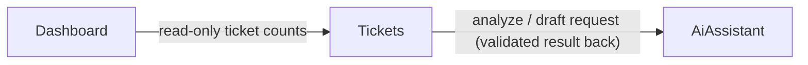

# Components — SupportDesk AI

Sources: `inception/requirements-analysis/requirements.md` (FR1–FR12, NFR1–NFR10), `inception/user-stories/stories.md` (US1.1–US4.4), `inception/practices-discovery/team-practices.md` (thin controllers, services via DI, DTOs separate from entities, no unnecessary layers), and the answers in `domain-design-questions.md`. Decisions are recorded in `decisions.md` (ADR-001 to ADR-005).

## Component Catalogue

```yaml
components:
  - name: Tickets
    summary: Owns support tickets and every change to them, including applying validated AI results.
    behaviour: >
      Creates tickets with Status Open and Priority Medium after validating title (3-200 chars) and
      description (10-4000 chars) on trimmed text. Lists tickets newest CreatedAt first (ties by Id
      descending) with optional, case-insensitive status/priority/category filters. Gets one ticket or
      reports not-found. Updates title, description and priority only; status changes only through the
      status operation, which accepts any of Open, InProgress, Resolved, Closed from any status.
      Runs the analyze flow (load ticket -> ask AiAssistant -> receive an already-validated result ->
      save Category, Sentiment, AiSummary, SuggestedAction and overwrite Priority) and the draft flow
      (load ticket -> ask AiAssistant -> save DraftReply and DraftReplyGeneratedAt, replacing any
      earlier draft). AI features work for any status. Any AI failure leaves the ticket unchanged.
      Refreshes UpdatedAt on every change. Never sends a reply anywhere. Never calls the AI for
      create, list, get, update or status, so those keep working when the AI is down.
    responsibilities:
      - Ticket lifecycle and validation rules (FR2, FR5, FR6)
      - Ticket listing and filtering (FR3, FR4)
      - Orchestrating analyze and draft-reply and persisting their validated results (FR7, FR8)
      - Being the only writer of ticket data
    depends_on:
      - component: AiAssistant
        interaction: Requests a ticket analysis or a reply draft and receives a validated typed result or a typed AI failure
        style: sync
    dependents:
      - component: Dashboard
        interaction: Dashboard reads ticket data (read-only) to count tickets
    external_dependencies:
      - name: SQLite (via EF Core)
        kind: database
        purpose: Persist tickets across restarts
    entities:
      - name: Ticket
        identifier: Id
        attributes: [Id, Title, Description, Status, Priority, Category, Sentiment, AiSummary, SuggestedAction, DraftReply, DraftReplyGeneratedAt, CreatedAt, UpdatedAt]

  - name: AiAssistant
    summary: Talks to the AI provider and turns its untrusted output into validated, typed results.
    behaviour: >
      Exposes the IAiTicketService contract with two operations: analyze a ticket's title and
      description, and draft a reply. Two interchangeable providers implement it: a deterministic,
      clearly labelled Mock (default, no network, output marked [MOCK]) and Groq (OpenAI-compatible
      chat completions), chosen by configuration. Builds prompts that wrap ticket text as data and ask
      for JSON only. Applies a configurable timeout (default 20 s) and honours cancellation. Validates
      every response before returning it: must be JSON with category, priority, sentiment in the
      allowed lists (case- and space-tolerant), summary and suggestedAction 1-500 chars; drafts
      1-4000 chars. Anything else becomes an "invalid AI output" failure. Reports timeout, provider
      error and "not configured" (Groq with no key) as distinct failures. Never executes AI output,
      never logs or returns the API key or raw provider responses, holds no ticket data.
    responsibilities:
      - IAiTicketService contract and provider selection (FR11)
      - Mock and Groq providers (FR11)
      - Prompt construction that treats ticket text as data (NFR4)
      - AI-output validation for analysis and drafts (FR7.2, FR8.2)
      - Timeout and failure classification (NFR3, FR10.2)
    depends_on: []
    dependents:
      - component: Tickets
        interaction: Tickets requests analyses and drafts
    external_dependencies:
      - name: Groq API (OpenAI-compatible chat completions)
        kind: third-party-api
        purpose: Real AI analysis and reply drafting when configured
    entities: []

  - name: Dashboard
    summary: Produces summary counts of tickets for the support lead.
    behaviour: >
      Returns total, open (Status Open), inProgress, resolved, closed, highPriority (Priority High or
      Critical, any status) and unanalyzed (Category not set). Uses read-only queries over ticket data
      and never writes. Returns all zeros when there are no tickets. Never calls the AI.
    responsibilities:
      - Dashboard summary counts (FR9)
    depends_on:
      - component: Tickets
        interaction: Reads ticket data owned by Tickets, read-only, to compute counts
        style: sync
    dependents: []
    external_dependencies:
      - name: SQLite (via EF Core)
        kind: database
        purpose: Read-only count queries over the Ticket table
    entities: []
```

## Component Diagram



<!-- Text fallback: Tickets calls AiAssistant to analyze tickets and draft replies and receives validated results. Dashboard reads ticket data owned by Tickets, read-only, to compute counts. AiAssistant depends on no other component. -->

Shared plumbing that is not a building block (it owns no business data or rules): the HTTP controllers for each component, the global exception handler that maps typed failures to ProblemDetails (ADR-005), Swagger, configuration binding, and the EF Core database context.

## Component Summary

| Component | Purpose | Depends On | Dependents | Entities Owned |
|---|---|---|---|---|
| Tickets | Ticket lifecycle, filtering, analyze/draft orchestration, only writer of ticket data | AiAssistant | Dashboard | Ticket |
| AiAssistant | AI provider access (Mock, Groq), prompts, AI-output validation, timeouts | — | Tickets | — |
| Dashboard | Summary counts | Tickets (read-only data) | — | — |

## Entity Ownership

| Entity | Owning Component | Identifier | Attributes | References |
|---|---|---|---|---|
| Ticket | Tickets | Id | Id, Title, Description, Status, Priority, Category, Sentiment, AiSummary, SuggestedAction, DraftReply, DraftReplyGeneratedAt, CreatedAt, UpdatedAt | — |

AI analysis results and drafts are transient values passed from AiAssistant to Tickets; they are stored only as fields of Ticket. Types, limits and allowed values are specified in Functional Design.

## External Dependencies

| Component | Dependency | Kind | Purpose |
|---|---|---|---|
| Tickets | SQLite (via EF Core) | database | Persist tickets across restarts |
| AiAssistant | Groq API | third-party-api | Real AI analysis and drafts when configured |
| Dashboard | SQLite (via EF Core) | database | Read-only count queries |

## Rationale

| Component | Why it is a separate building block |
|---|---|
| Tickets | Distinct data ownership: the only component that stores and changes tickets, so every ticket rule (validation, status, AI result application, UpdatedAt) lives in one place. |
| AiAssistant | Distinct concern and change rate: provider, prompts and validation change independently of ticket rules; isolating untrusted AI output behind one boundary enforces the "never save unvalidated AI output" rule and lets tests replace the AI with a fake. |
| Dashboard | Distinct reader with no writes and no rules about tickets' lifecycle; keeping counting out of Tickets keeps Tickets focused and lets the dashboard work whatever the AI state. |

**Alternatives rejected** (see ADR-001): a fourth TicketAiWorkflow block (extra layer for a two-step flow, against the "no unnecessary layers" practice) and a two-block split folding Dashboard into Tickets (mixes reporting with lifecycle rules).
