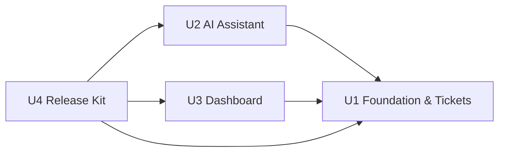

# Unit Dependencies — SupportDesk AI

Topology only. The build order is chosen in Delivery Planning. Units are defined in `unit-of-work.md`; components and decisions come from `inception/domain-design/components.md` and `decisions.md`.

## Dependency Graph



<!-- Text fallback: U2 depends on U1. U3 depends on U1. U4 depends on U1, U2 and U3. U1 depends on nothing. There are no cycles. -->

| Unit | Depends on | Why |
|---|---|---|
| U1 Foundation & Tickets | — | The base project, database and Ticket entity everything else uses. |
| U2 AI Assistant | U1 | Its flows load and save tickets via the Tickets service and DbContext; its failures are mapped by U1's exception handler. |
| U3 Dashboard | U1 | Counts the Ticket table created by U1. |
| U4 Release Kit | U1, U2, U3 | Documents and example-requests every endpoint, so all endpoints must exist. |

## Integration Points

| From | To | Mechanism | What crosses |
|---|---|---|---|
| U2 | U1 | In-process service call + shared DbContext | Ticket load/save for analyze and draft; AI-field writes on Ticket |
| U2 | U1 | Exceptions to the global handler | Typed AI failures (invalid output, timeout, provider error, not configured) -> 502/504/502/503 |
| U2, U1 | shared Domain folder (in U1) | Shared enums | Status, Priority, Category, Sentiment |
| U3 | U1 | Read-only EF queries | Ticket table counts (schema coupling, no writes) |
| U4 | U1, U2, U3 | Documentation | Endpoint shapes and configuration keys |

## Parallel Development Opportunities

- After U1, **U2 and U3 have no dependency on each other** and can be built in either order or in parallel.
- U4 can start its README skeleton early but completes only after U1–U3.
- Valid topological orders include: U1, U2, U3, U4 and U1, U3, U2, U4.

## Thin Slice

The classic scope runs no formal skeleton checkpoint (team practices: `skeleton: off`), but U1 is shaped so its first commits are the smallest working integrated slice: create, list and get a ticket through controller, service and SQLite, verified by `dotnet build && dotnet test` and by the ticket surviving a restart. U1 has no dependencies, so it can run before any later unit.

## Edge Block

```yaml
units:
  - name: u1-foundation-tickets
    kind: service
    depends_on: []
  - name: u2-ai-assistant
    kind: service
    depends_on: [u1-foundation-tickets]
  - name: u3-dashboard
    kind: service
    depends_on: [u1-foundation-tickets]
  - name: u4-release-kit
    kind: packaging
    depends_on: [u1-foundation-tickets, u2-ai-assistant, u3-dashboard]
```
